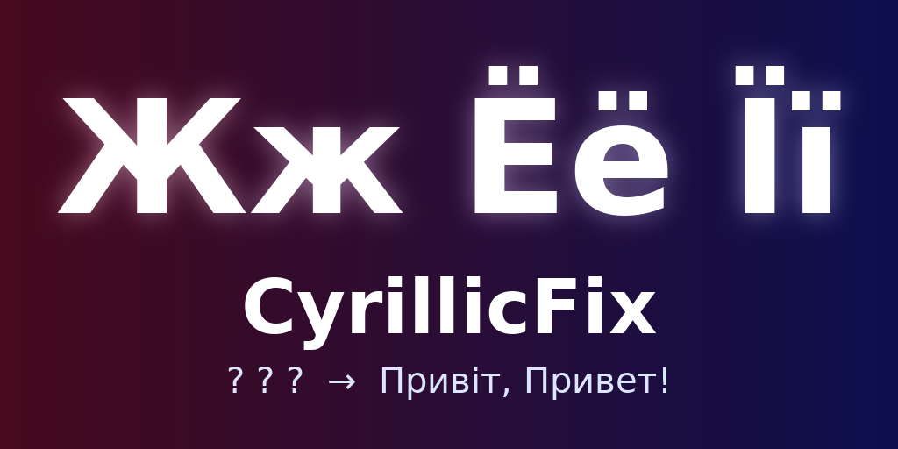

# CyrillicFix



A Beat Saber mod for **Meta Quest** that fixes Cyrillic text: song names, artists and mappers that show up as `?` and `.`.

- **Game version:** 1.40.8_7379
- **Mod loader:** Scotland2 (installed by [ModsBeforeFriday](https://mbf.bsquest.xyz))

## How it works

The game's own fonts (Teko plus the JP/KR/CN fallback fonts) have no Cyrillic glyphs, or broken ones.
The Unicode mod only steps in when TextMeshPro finds no glyph at all. If one of the game's fallback fonts
returns a garbage glyph (`?`, `.`) for a letter, Unicode never gets a chance. When it does draw a letter,
it renders the glyph as a bitmap sprite, which looks out of place next to normal text.

CyrillicFix:

1. The first time you open the main menu, it builds a real **dynamic SDF TextMeshPro font asset** from a TTF file.
   That's either an Android/Horizon OS system font (Roboto or Noto Sans, which always include Cyrillic)
   or **your own font** (see below).
2. It hooks `TMP_Text.GetTextElement`, the function TMP uses to look up a glyph for every character. For every Cyrillic
   code point (U+0400-U+052F, the Extended-A/B/C blocks and the numero sign `№`), it **always** returns the glyph from that font,
   whatever the game's fonts claim to have.
3. All other characters keep the game's behaviour. Latin text stays in Teko, and emoji and CJK still go through Unicode.
   **CyrillicFix works alongside Unicode**, so keep both installed.

Every Cyrillic language is covered: Russian, Ukrainian (і ї є ґ), Belarusian (ў), Serbian, Kazakh, and so on.

## Installation

1. Open [ModsBeforeFriday](https://mbf.bsquest.xyz) and connect your headset.
2. Drag `CyrillicFix.qmod` from the [latest release](../../releases/latest) onto the MBF window.
3. Launch the game.

## Custom font (optional)

Put any TTF/OTF font with Cyrillic support here:

```
/sdcard/ModData/com.beatgames.beatsaber/Mods/CyrillicFix/font.ttf
```

The folder is created on the first launch with the mod. Narrow fonts such as **Oswald** or **Roboto Condensed**
(free on Google Fonts) are closest in style to Teko. Restart the game after adding the font.

## Troubleshooting

The mod's log is written to:

```
/sdcard/ModData/com.beatgames.beatsaber/logs2/cyrillic-fix.log
```

It contains a `Using font ...` line and diagnostics: the game's font assets, whether they contain Cyrillic,
their fallback chains and the relevant TMP settings. Please attach it when opening an issue.

**Note:** if the question marks are stored in the map file itself (for example `"_songName": "????"` in `info.dat`,
which happens when a mapper saved the map with the wrong encoding), the text itself is broken and no font mod can fix it.
You can check the `info.dat` of the song in
`/sdcard/ModData/com.beatgames.beatsaber/Mods/SongCore/CustomLevels/<song folder>/`.

## Building

You need [QPM](https://github.com/QuestPackageManager/QPM.CLI/releases/latest), CMake, Ninja and Python 3.

```sh
qpm ndk resolve -d
qpm restore
qpm qmod zip
```

GitHub Actions builds the mod on every push. Pushing a tag like `v1.0.1` publishes a GitHub release
with the `.qmod` attached (the version is taken from the tag).

## License

[MIT](LICENSE)
